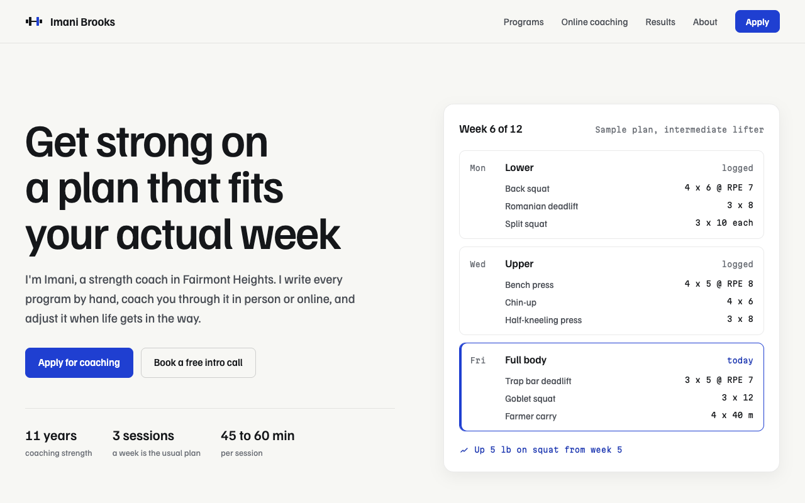

# Imani Brooks Coaching: personal trainer website template

A website for a personal trainer or strength coach: programs and packages with prices, sample client results, online coaching, an about page and an application form. Built with Astro as a fully static site.



[](https://console.cloudzyro.com/new?repo=https://github.com/Cloudzyro/template-personal-trainer)

## What's included

- Home page with a sample training week shown as a coach's log (sets, reps and target effort)
- Programs page: one-to-one packs, small group and online coaching tiers with prices and what each includes
- Results page with sample client stories and before and after numbers, clearly marked as samples
- Online coaching page: how it works step by step, what clients need, plans
- About page with qualifications and how you program
- Application form that works without a server, plus a link to book a free intro call
- Open Graph tags, structured data, sitemap, robots.txt and favicon
- Responsive down to 360px, keyboard friendly, visible focus styles, reduced motion respected
- No tracking and no third-party scripts

## Run it locally

You need Node 22.23 or newer and pnpm.

```bash
pnpm install
pnpm dev       # http://localhost:4321
pnpm build     # static site in dist/
pnpm preview   # serve the build
```

## Make it yours

- **Content:** everything lives in `src/data/site.ts`: your name, contact details, studio address, the sample week in the hero, programs and prices, results, the online coaching steps and your about page.
- **Intro calls:** set `bookingUrl` in `src/data/site.ts` to your Calendly, Cal.com or Acuity page (or a `tel:` link).
- **Application form:** set `PUBLIC_FORM_ENDPOINT` to a form service address (Formspree, Basin, a Supabase function or similar). The form posts its fields there. With no endpoint set, the form shows a short note and opens the visitor's email app addressed to your `email`.
- **Site address:** set `SITE_URL` (for example `https://www.yourname.com`) so the sitemap, canonical links and social previews use it.
- **Colors and fonts:** the variables at the top of `src/styles/global.css`. Fonts are Familjen Grotesk and Martian Mono, self-hosted through Fontsource.
- **Photos:** the portrait on the about page is an SVG placeholder in `src/pages/about.astro`. Put your photo in `src/assets/` and use Astro's `<Image>` component in its place.
- **Social preview image:** replace `public/og.png` (1200 x 630).

Copy `.env.example` to `.env` to set the variables locally. On Cloudzyro, add them in your site's environment settings.

## Deploy

Click the button above to make your own copy and put it online, or push your copy to GitHub and connect the repository in the Cloudzyro console. It builds with `pnpm build` and serves the static `dist/` folder.

## Stack

- [Astro](https://astro.build) 7, static output
- `@astrojs/sitemap`
- Familjen Grotesk and Martian Mono via Fontsource
- Plain CSS and a few lines of TypeScript for the menu and the form

## License

MIT, see [LICENSE](./LICENSE).
